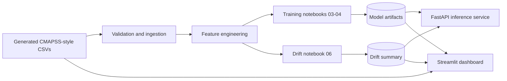
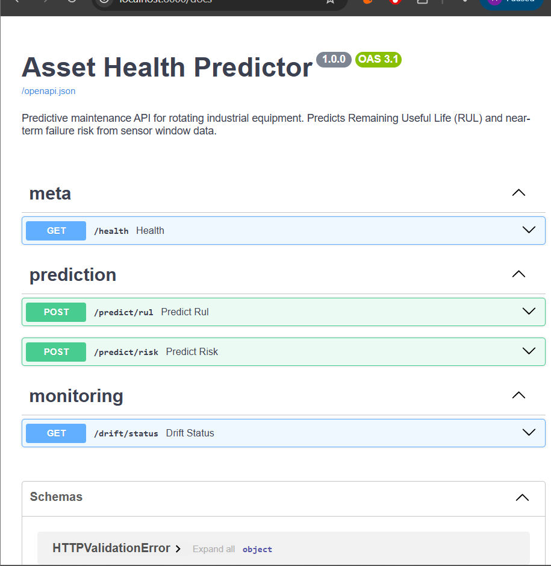

# Predictive Asset Health Monitor

An applied machine-learning project for estimating **Remaining Useful Life (RUL)** and near-term failure risk from engine sensor histories. It includes a reproducible synthetic CMAPSS-style data generator, feature engineering, model experiments, a FastAPI inference service, and a Streamlit dashboard.

[](https://github.com/sindhu-1213/asset-failure-prediction/actions/workflows/ci.yml)


[Repository](https://github.com/sindhu-1213/asset-failure-prediction) · [Streamlit demo](https://asset-failure-prediction.streamlit.app/)

## Project Overview

The project demonstrates a small end-to-end predictive-maintenance workflow:

- Generate or load engine-cycle sensor records.
- Validate the tabular input and build per-engine degradation features.
- Train regression and classification models in ordered Jupyter notebooks.
- Save model artifacts and a cost-selected classification threshold.
- Serve predictions through FastAPI and explore synthetic test units in Streamlit.
- Produce a feature-distribution drift report using a two-sample KS test.

This is a portfolio and learning project using simulated engine data. It is not a production-qualified maintenance system.

## Problem Statement

Maintenance teams need an estimate of how much useful operating life may remain and whether an asset is approaching failure. This project frames those tasks as:

1. **RUL regression:** estimate remaining cycles for a unit.
2. **Near-term risk classification:** estimate whether the unit's RUL is within a 30-cycle horizon.

The work uses engine-simulation-style records. It does not use real factory telemetry, maintenance records, or a customer asset inventory.

## Key Features

| Area | Implemented behavior |
|---|---|
| Data checks | Required-column, missing-value, sensor-range, and cycle-continuity checks |
| Feature engineering | RUL/failure labels, rolling means and standard deviations, 15-cycle slopes, and cumulative sensor deviation |
| RUL models | Linear regression baseline, XGBoost regressor, and PyTorch LSTM |
| Failure risk | Logistic-regression baseline and XGBoost classifier for the 30-cycle target |
| Cost threshold | Validation threshold sweep using configurable false-negative and false-positive costs |
| Drift analysis | KS tests against training feature distributions; notebook scenarios include simulated drift |
| API | FastAPI health, RUL, risk, and drift-status endpoints |
| Dashboard | Streamlit demo-unit risk/RUL views, sensor histories, manual next-cycle scoring, feature importance, and drift summary |
| Experiment tracking | MLflow runs in the advanced-modeling notebook |
| Tests and CI | pytest suite; GitHub Actions runs tests on pushes and pull requests to `main` |

## System Architecture



The Streamlit dashboard loads the XGBoost artifacts and scores the generated test data itself; it does not call the FastAPI service.

## Technology Stack

| Category | Technologies |
|---|---|
| Language | Python |
| Machine learning | scikit-learn, XGBoost, PyTorch |
| Backend/API | FastAPI, Uvicorn, Pydantic |
| Dashboard | Streamlit |
| Data processing | pandas, NumPy, SciPy |
| Monitoring and tracking | SciPy KS test, MLflow |
| Testing | pytest |
| CI | GitHub Actions |
| Container files | Dockerfile and Docker Compose configuration are present; see [limitations](#project-limitations-and-future-work) |

## Dataset and Data Provenance

The repository's `scripts/generate_cmapss_data.py` creates **synthetic CMAPSS-style** records. Its sensor baselines and degradation trends are based loosely on the FD001 data format and behavior; the checked-in CSVs are generated demo data, not a downloaded copy of NASA's dataset.

| File | Purpose |
|---|---|
| `data/raw/train_FD001.csv` | Generated training units with simulated run-to-failure histories |
| `data/raw/test_FD001.csv` | Generated demo units with histories truncated before failure |
| `data/raw/rul_FD001.csv` | Generated remaining-life reference for the truncated test units |

The default generator creates 80 training units and 20 test/demo units. These `unit_id` values are synthetic identifiers, not real machines. No real industrial factory sensor data or customer asset data is included. The loader can also parse NASA-style space-delimited `.txt` files if supplied separately, but such raw NASA files are not included here.

## Machine-Learning Methodology

- **Labels:** training RUL is the last observed cycle for each training unit minus the current cycle. The classifier target is positive when RUL is at most 30 cycles.
- **Sensors:** the feature builder excludes six identified flat channels and uses the remaining 15 sensors.
- **Features:** raw informative sensor readings; rolling mean and standard deviation over 5, 15, and 30 rows; 15-row linear slope; and normalized cumulative absolute deviation. The resulting model matrix has 135 features.
- **Split:** notebooks 03–05 use `GroupShuffleSplit(test_size=0.2, random_state=42)` by unit ID to keep units in the validation set separate from training units.
- **Models:** the baselines are linear regression and logistic regression. Notebook 04 fits the XGBoost RUL regressor and classifier, plus an LSTM RUL model. The Streamlit dashboard and API serve the two XGBoost models.
- **Monitoring:** notebook 06 compares feature distributions with two-sample KS tests. Its notebook includes same-distribution and simulated-shift scenarios; the resulting report is not evidence of live production drift.

## Model Evaluation and Recorded Metrics

The figures below are copied from the **saved outputs** of notebooks 03–05 in this repository. They use the generated FD001-style training data, with a grouped validation split of 64 training units / 15,463 rows and 16 validation units / 3,671 rows. RUL regression metrics are calculated over validation rows. The synthetic `test_FD001.csv` and its RUL reference are not used to produce this comparison.

| Task | Model / operating point | Evaluation data and split | Recorded metrics |
|---|---|---|---|
| RUL regression | Linear regression baseline | Synthetic training rows; grouped validation, 16 units | RMSE **71.56** cycles; MAE **60.15** cycles; NASA score **81,686,630** |
| RUL regression | XGBoost | Same grouped validation split | RMSE **63.38** cycles; MAE **51.46** cycles; NASA score **190,816,455** |
| RUL regression | LSTM | Same grouped validation rows; notebook predicts per row | RMSE **73.24** cycles; MAE **58.17** cycles; NASA score **1,583,084,574** |
| Failure classification | Logistic regression, threshold 0.5 | Synthetic training rows; grouped validation, 16 units | AUC **0.8130**; F1 **0.4000** |
| Failure classification | XGBoost, threshold 0.5 | Same grouped validation split | AUC **0.8447**; F1 **0.4338** |
| Failure classification | XGBoost, cost-selected threshold 0.01 | Same grouped validation split | AUC **0.8447**; F1 **0.3984**; precision **0.2501**; recall **0.9778** |

The notebooks' validation outputs are the source for this table. The separate [`docs/model_card.md`](docs/model_card.md) contains different numerical results without matching split/output evidence in this checkout; those conflicting figures are not repeated here and the model card needs reconciliation. In the recorded results, XGBoost has lower RUL RMSE than the baseline but a higher (worse) NASA score, so no single metric establishes an overall winner. No real-world or industrial validation has been performed.

## MLOps Pipeline

Run the notebooks in order; they create files consumed by later stages:

| Order | Notebook | Main output |
|---:|---|---|
| 1 | `notebooks/01_eda.ipynb` | Data checks and exploratory analysis |
| 2 | `notebooks/02_feature_engineering.ipynb` | `data/processed/train_features.csv` |
| 3 | `notebooks/03_baseline_modeling.ipynb` | Baseline model artifacts and metrics |
| 4 | `notebooks/04_advanced_modeling.ipynb` | XGBoost artifacts, LSTM artifact, MLflow runs, and metrics |
| 5 | `notebooks/05_threshold_cost_analysis.ipynb` | `models/artifacts/best_threshold.json` |
| 6 | `notebooks/06_drift_analysis.ipynb` | `models/artifacts/drift_monitor.json` and `last_drift_report.json` |

The checked-in serving artifacts are `models/artifacts/xgb_rul.pkl`, `xgb_clf.pkl`, `best_threshold.json`, and `last_drift_report.json`. Other training outputs such as baseline pickles, the LSTM `.pt` file, processed features, and the drift reference file are generated locally and ignored by Git.

GitHub Actions runs the three test modules on Python 3.10 and 3.11 for pushes and pull requests to `main`. It generates the synthetic data before testing; this workflow does not train models or deploy the dashboard.

## API Documentation and Example

Start the API from the repository root. FastAPI's interactive documentation is available at [http://127.0.0.1:8000/docs](http://127.0.0.1:8000/docs).

| Method | Endpoint | Response purpose |
|---|---|---|
| `GET` | `/health` | API status and whether both XGBoost models loaded |
| `POST` | `/predict/rul` | Predicted RUL and a confidence label |
| `POST` | `/predict/risk` | Failure probability, threshold, alert flag, and risk level |
| `GET` | `/drift/status` | Saved drift report, if available |

Both prediction endpoints accept `unit_id` and a non-empty `cycles` list. Each cycle record needs `cycle`, `op1`–`op3`, and all sensor fields `s1`–`s21`. To exercise the API using actual records from the included synthetic test file:

```python
import pandas as pd
import requests

unit = pd.read_csv("data/raw/test_FD001.csv")
unit = unit.loc[unit["unit_id"] == 1].sort_values("cycle").head(30)
cycles = unit.drop(columns="unit_id").to_dict(orient="records")
payload = {"unit_id": 1, "cycles": cycles}

print(requests.post("http://127.0.0.1:8000/predict/rul", json=payload).json())
print(requests.post("http://127.0.0.1:8000/predict/risk", json=payload).json())
```

## Dashboard Screenshots and Demo

The current dashboard is implemented in [`dashboard/app.py`](dashboard/app.py) and can be launched locally using the instructions below. The committed dashboard screenshots in `docs/screenshots/` show an earlier dashboard layout and are not presented as screenshots of the current UI. The API documentation screenshot is available here:



The Streamlit Community Cloud app is linked above. It presents generated demo units; it is not connected to a live industrial sensor feed.

## Local Installation and Setup

The following commands use **PowerShell** from the repository root. Python 3.10 and 3.11 are the versions configured in CI.

```powershell
git clone https://github.com/sindhu-1213/asset-failure-prediction.git
Set-Location asset-failure-prediction

py -3.11 -m venv .venv
.\.venv\Scripts\Activate.ps1
python -m pip install --upgrade pip
python -m pip install -r requirements.txt
python -m pip install notebook
```

Jupyter Notebook is not included in `requirements.txt`, so install it separately to run the notebooks. If PowerShell blocks environment activation, use the Python executable at `.venv\Scripts\python.exe` directly.

## Generate Data and Train Models

Generate the synthetic input CSVs and create the processed-data directory required by notebook 02:

```powershell
python scripts/generate_cmapss_data.py --out data/raw
New-Item -ItemType Directory -Force data\processed
```

Open Jupyter and run every cell top-to-bottom for each notebook in the order listed in [MLOps Pipeline](#mlops-pipeline):

```powershell
python -m notebook notebooks
```

Notebook 02 writes `data/processed/train_features.csv` but does not create its parent directory, which is why the setup command creates it first.

## Run the FastAPI Service

From the repository root, with the XGBoost artifacts present:

```powershell
python -m uvicorn src.serving.api:app --reload --port 8000
```

Open [http://127.0.0.1:8000/docs](http://127.0.0.1:8000/docs). The API expects artifact paths relative to its working directory by default (`models/artifacts`); run it from the repository root or set `ARTIFACTS_DIR`.

## Launch the Streamlit Dashboard

In another PowerShell terminal, from the repository root:

```powershell
python -m streamlit run dashboard/app.py
```

Open [http://localhost:8501](http://localhost:8501). The app locates model artifacts relative to its own file and reads demo records from `data/raw/`. The manual prediction form starts from a selected synthetic unit's observed history and scores one next-cycle sensor reading using the existing feature builder and XGBoost wrappers.

## Running Tests

Run the full test suite from the repository root:

```powershell
python -m pytest tests/ -v
```

The current suite contains **42 tests** across schema/range/cycle validation, feature and label behavior, and FastAPI endpoint structure/error handling. The command was run during this README audit: **42 passed**. These are automated software tests; they are not validation against real industrial equipment or maintenance outcomes.

## Project Limitations and Future Work

- **Simulated data only:** validate with representative, governed industrial data before drawing operational conclusions.
- **Evaluation needs strengthening:** add held-out unit evaluation using the supplied synthetic test/RUL files and record model, data, and preprocessing versions alongside metrics.
- **Model-card mismatch:** reconcile `docs/model_card.md` with the recorded notebook outputs.
- **Drift report is a simulation:** the checked-in report was generated by notebook scenarios, including simulated feature shifts; it is not a live monitoring result.
- **Illustrative business scenario:** notebook 05 reports a simulated annual net benefit of **$2,073,359** for a hypothetical 500-unit fleet. It assumes a 15% annual failure rate, the validation precision/recall at threshold 0.01, $50,000 per missed failure, and $5,000 per false alarm. This is a calculation under assumed inputs, not measured savings or customer impact; it also differs from the older README's unsupported $3.2M claim.
- **No model explainability package:** the dashboard shows XGBoost's built-in classifier feature importance, not SHAP values, causal effects, or per-prediction explanations.
- **Container setup is incomplete:** `Dockerfile` is empty in the current checkout, so the API image build configured by `docker-compose.yml` is not currently usable. Docker support should not be considered verified.
- **Production hardening:** add data/schema validation at the API boundary, model/version metadata, monitoring on real production batches, and deployment integration tests.
- **No operational or safety validation:** outputs are advisory and are not intended for safety-critical control decisions.

## Repository Structure

```text
.
├── .github/workflows/ci.yml
├── dashboard/app.py
├── data/raw/
│   ├── rul_FD001.csv
│   ├── test_FD001.csv
│   └── train_FD001.csv
├── docs/
│   ├── model_card.md
│   └── screenshots/
├── models/artifacts/
│   ├── best_threshold.json
│   ├── last_drift_report.json
│   ├── xgb_clf.pkl
│   └── xgb_rul.pkl
├── notebooks/
│   ├── 01_eda.ipynb
│   ├── 02_feature_engineering.ipynb
│   ├── 03_baseline_modeling.ipynb
│   ├── 04_advanced_modeling.ipynb
│   ├── 05_threshold_cost_analysis.ipynb
│   └── 06_drift_analysis.ipynb
├── scripts/generate_cmapss_data.py
├── src/
│   ├── __init__.py
│   ├── features/
│   │   ├── __init__.py
│   │   └── build_features.py
│   ├── ingestion/
│   │   ├── __init__.py
│   │   ├── load_data.py
│   │   └── validate.py
│   ├── models/
│   │   ├── __init__.py
│   │   ├── baseline.py
│   │   ├── evaluate.py
│   │   ├── lstm_model.py
│   │   └── xgboost_model.py
│   ├── monitoring/
│   │   ├── __init__.py
│   │   └── drift_check.py
│   └── serving/
│       ├── __init__.py
│       └── api.py
├── tests/
│   ├── conftest.py
│   ├── test_api.py
│   ├── test_features.py
│   └── test_validate.py
├── Dockerfile
├── docker-compose.yml
├── LICENSE
├── Makefile
└── requirements.txt
```

`data/processed/` and several notebook-generated model files are local outputs and are ignored by Git.


